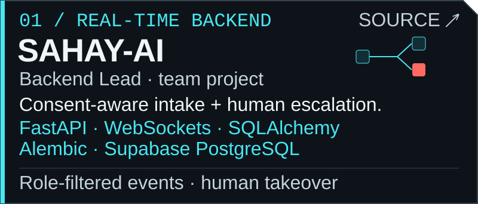
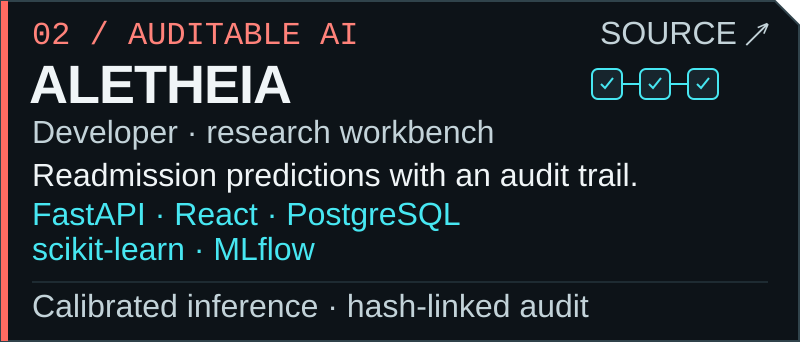
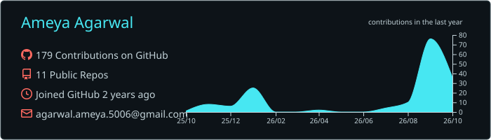
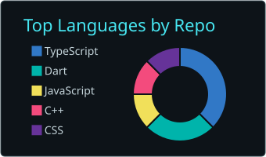
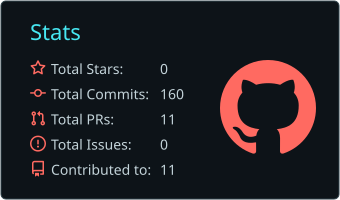

  

  

I build reliable backends, AI/ML-powered products, full-stack web apps and Flutter applications. 
Follow the signal: working systems, clear boundaries, useful interfaces.

   
  <a href="https://tenor.com/view/user7122-gif-21263889">Via Tenor</a>

## 01 / Flagship systems

**SAHAY-AI · Backend Lead, team project.** AI-assisted intake and human escalation prototype. I led backend work across async APIs, WebSocket event routing, consent controls and the Supabase PostgreSQL migration.

`FastAPI` · `WebSockets` · `SQLAlchemy` · `Alembic` · `Supabase PostgreSQL` 
**Signals:** role-filtered events · human takeover 
[Inspect the repository ↗](https://github.com/advay-sinha/SAHAY-AI)

**Aletheia · Developer.** An auditable workbench for manually entered readmission research cases. I built the prediction-to-review workflow: calibrated inference, reference-dependent explanations, saved history and hash-linked audit records.

`FastAPI` · `React` · `PostgreSQL` · `scikit-learn` · `MLflow` 
**Signals:** calibrated inference · hash-linked audit records 
[Inspect the repository ↗](https://github.com/Ameya5006/Aletheia) · [Recorded walkthrough ↗](https://github.com/Ameya5006/Aletheia/blob/main/docs/assets/demo/walkthrough.webm) 
Educational research only; explanations are noncausal. Creating predictions requires provisioned access.

## 02 / More builds

### [GymFlow](https://github.com/Ameya5006/Dual-gym-website) · Member + admin platform

I developed the full-stack membership platform for Fitness First Boxing Club and Nisha Fitness, documented as in production. Firebase Auth, Firestore and Apps Script connect member/admin workflows, Google Sheets sync, WhatsApp notifications and UPI links.

`React` · `TypeScript` · `Firebase Auth / Firestore` · `Apps Script` 
[Source ↗](https://github.com/Ameya5006/Dual-gym-website) · [Live site ↗](https://boxingguruji.vercel.app/)

### [PalmChef](https://github.com/Ameya5006/PalmChef) · Hands-free kitchen

I built a React PWA cooking assistant with MediaPipe gesture navigation, voice controls and an Express backend. Gemini tool calling is implemented in source; its separate AI service is documented as awaiting deployment.

`React` · `MediaPipe` · `Node.js / Express` · `Gemini API` 
[Source ↗](https://github.com/Ameya5006/PalmChef) · [Live interface ↗](https://palmchef-14qa.onrender.com)

### [Amedic](https://github.com/Ameya5006/Amedic) · Health, made visible

I built a Flutter health app with pedometer input, BMI/BMR calculations and health visualizations. Its dashboard includes sample chart data, so the charts demonstrate the interface rather than a verified history of measured health data.

`Flutter` · `Dart` · `pedometer` · `fl_chart` 
[Source ↗](https://github.com/Ameya5006/Amedic)

### [FloatChat / ARGO Mobile](https://github.com/Ameya5006/FloatChat_app) · Ocean-data explorer

I independently developed the Flutter mobile application within the larger team project. The prototype pairs an interactive ocean map with sample ARGO float profiles; chat responses and download actions are simulated demonstrations.

`Flutter` · `Dart` · `flutter_map` · `latlong2` 
[Source ↗](https://github.com/Ameya5006/FloatChat_app)

## `// tech_deck`

  
  
  
  
  
  
  
  
  
  
  
  
  
  
  
  
  
  
  
  
  
  
  
  

  <code>Gemini&nbsp;API</code> ·
  <code>MediaPipe</code> ·
  <code>SQLAlchemy</code> ·
  <code>Alembic</code> ·
  <code>WebSockets</code> ·
  <code>MLflow</code> ·
  <code>scikit&#8209;learn</code> ·
  <code>Apps&nbsp;Script</code> ·
  <code>JWT/RBAC</code> ·
  <code>REST&nbsp;APIs</code> ·
  <code>Google&nbsp;Sheets</code> ·
  <code>WhatsApp&nbsp;workflows</code> ·
  <code>UPI&nbsp;workflows</code>

<b>▸ Open the utility drawer</b>

**Web & data** / `Zustand` · `React Router` · `Mongoose` · `Firestore` · `Firebase Authentication` · `PWA` · `Web Speech API` · `Responsive design`

**Delivery & quality** / `Pytest` · `Ruff` · `Playwright` · `GitHub Actions` · `Render` · `PostgreSQL TLS/RLS`

**AI workflow** / `Tool calling` · `Explainable AI (reference-based)` · `Model calibration`

**Deck index** / HTML · CSS · JavaScript · TypeScript · Python · C++ · Dart · React · Flutter · FastAPI · Vite · Tailwind CSS · Node.js · Express.js · MongoDB · Firebase · PostgreSQL · Supabase · Docker · Nginx · Vercel · Git · GitHub · Azure

## 04 / GITHUB SIGNAL ANALYTICS

  

  
  

Language statistics use public repositories’ primary languages; **they do not measure proficiency**. 
Activity follows GitHub’s contribution rules and can differ from Git history. Open a card for full-size details.

  <picture>
    <source media="(prefers-color-scheme: dark)" srcset="assets/analytics/contribution-snake-dark.svg" />
    <source media="(prefers-color-scheme: light)" srcset="assets/analytics/contribution-snake-light.svg" />
    
  </picture>

[Follow the build log: commits, contributions and experiments ↗](https://github.com/Ameya5006?tab=overview)

## 05 / Ship log

- **Hackathon** / Smart India Hackathon — **6th out of 591 teams**.
- **Campus** / Placement Committee · Student Council, Sub Head — Operations · GeeksforGeeks core team.
- **Sport** / District-level boxing **silver** · fencing **bronze**.

## 06 / Contact core

**Have a system worth building? Let’s make it real.**

[Email](mailto:agarwal.ameya5006@gmail.com) · [LinkedIn](https://www.linkedin.com/in/ameya-agarwal/) · [Portfolio](https://ameya5006.github.io/) · [GitHub](https://github.com/Ameya5006)

